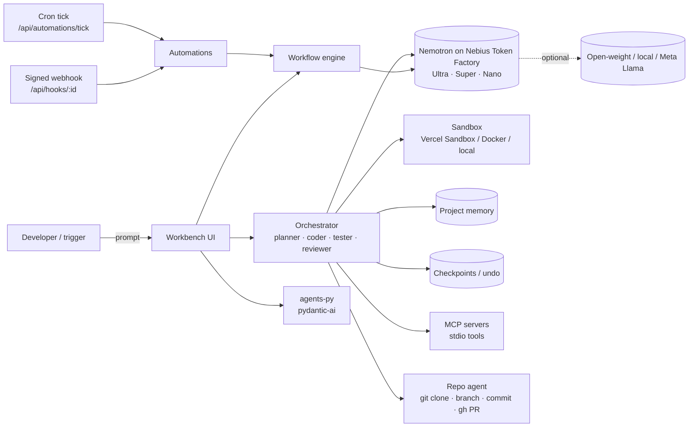

# BroCODE v2: open-source full-stack AI coding and agentic workspace

BroCODE v2 is a self-hostable workspace where AI agents plan, write, test, review and repair code, with evidence for every step (test log, model, tokens and cost). It runs NVIDIA Nemotron on Nebius Token Factory by default, and optional open-weight and local models when you select them.

This repository also holds the public website for [codingagent.in](https://codingagent.in), now under [`site/`](site/).

> Status: v2 is new. Features below are implemented and covered by offline tests. Live model calls need your own API keys and have not been run against production keys in this repo's CI.

## Repository layout

```
app/          Full-stack workspace (TanStack Start + React 19 + Vite, Nitro server, PGlite/Postgres)
  src/lib/agent/      Nemotron routing, providers, write→run→test→repair loop, sandbox, Tavily
  src/lib/v2/         NEW in v2: automations, cron, orchestrator, MCP client, repo agent, memory, checkpoints
  src/lib/…           pipeline (migration auditor), redteam, meridian, whisperer, pcm (project DNA),
                      workflow, board, collab (builder→reviewer handoff), skills
  src/routes/api/     /api/dna, /api/hooks/:id (webhook trigger), /api/automations/tick (cron tick)
  tests/              node:test suites (npm run test:agent)
agents-py/    Python agent service (FastAPI + pydantic-ai): /review, /plan, /evals/review
site/         Dependency-free static site generator for codingagent.in (unchanged content)
.github/      CI (site, app, agents-py), RedAgent and CI Whisperer workflows
```

## Architecture



## Features

Inherited from the Coding-Agent platform:

- **Nemotron routing on Nebius Token Factory**: Ultra plans and repairs, Super implements, Nano handles fast calls. Per-step model and USD cost in the UI.
- **Write → run → test → repair loop** in Vercel Sandbox, Docker (`--network=none`) or a local process (dev). Secrets are scrubbed from the sandbox environment.
- **Tavily research** with citations (optional).
- **Ship pipeline** with a migration auditor (blocks risky migrations scoring 4 or below), PGlite shadow runs, seed and smoke tests; deploy only after a human types DEPLOY.
- **RedAgent** red-team harness (`REDAGENT_MODE`), **MERIDIAN** 8-agent chain (security, compliance, CI/CD, GreenOps estimates, contracts), **CI Whisperer** GitHub Action, **Project DNA** endpoint (`/api/dna`, token-protected).
- **Workflow builder** (DAG with LLM, tool, check and condition nodes), **task board**, Ensemble-style **builder → reviewer handoff**, bundled **skills**.
- **Optional providers**: Meta Llama API (with a hard spend cap), local llama.cpp, Ollama, OpenRouter free tier, Hugging Face Inference, and the Nebius open-weight catalog. All opt-in.

New in v2 (`app/src/lib/v2/`):

| Capability | What ships | Status |
|---|---|---|
| Automations | Cron (5-field, UTC) and HMAC-signed webhook triggers that run workflows; run history; manual run | Real, tested. Scheduler state is in memory; definitions load from `BROCODE_AUTOMATIONS` |
| Multi-agent orchestrator | Planner (Ultra) → coder (Super) → tester (sandbox) → reviewer (Ultra), looping on test failures or review changes, round-capped, path-safe file parsing | Real, tested with injected models. Not yet wired into the workbench UI |
| MCP client | stdio JSON-RPC client: `initialize`, `tools/list`, `tools/call`, per-call tool allowlist, timeouts | Real, tested against a fixture server. HTTP/SSE transport not implemented |
| Repo-aware agent | `git clone` (https/file only), branch, apply files (path-safe), diff, commit; `gh pr create` | Real, tested on a local repo. Push and PR run only when `GH_TOKEN` and `BROCODE_ALLOW_PR=1` are set; otherwise a dry run returns the command |
| Project memory | Per-project JSONL store, keyword recall, prompt context block | Real, tested. Keyword scoring, not embeddings |
| Checkpoints and undo | Snapshot a file map, list, diff, restore, undo; capped history per project | Real, tested. Not yet wired into the workbench UI |

## Quickstart

Requirements: Node.js 22, and [uv](https://docs.astral.sh/uv/) for the Python service.

```bash
git clone https://github.com/CodesbyFebin/BroCode && cd BroCode

# App
cd app && cp .env.example .env    # add NEBIUS_API_KEY
npm install
npm run dev                        # http://localhost:8080
npm run test:agent                 # offline tests, no keys needed

# Python agents (optional)
cd ../agents-py && uv run pytest -q

# Site
cd ../site && npm ci && npm run build && npm run verify
```

### Automations example

`automations.json` (point `BROCODE_AUTOMATIONS` at it):

```json
[
  { "id": "nightly-review", "name": "Nightly review", "enabled": true,
    "trigger": { "kind": "cron", "cron": "0 2 * * *" }, "workflowId": "example", "input": "review main" },
  { "id": "on-push", "name": "On push", "enabled": true,
    "trigger": { "kind": "webhook", "secretEnv": "HOOK_SECRET" }, "workflowId": "example", "input": "check push" }
]
```

Call `POST /api/automations/tick` every minute with `Authorization: Bearer $BROCODE_CRON_TOKEN`. Send webhooks to `POST /api/hooks/on-push` with header `X-BroCODE-Signature: sha256=<HMAC-SHA256 of the raw body>`; a JSON body `{"input": "..."}` overrides the input.

## Environment variables

All keys are read server-side; none are hardcoded. Full list with comments: [`app/.env.example`](app/.env.example).

| Variable | Purpose |
|---|---|
| `NEBIUS_API_KEY` | Required for live model calls (Nemotron on Nebius Token Factory) |
| `NEBIUS_BASE_URL`, `NEBIUS_MODEL_{NANO,SUPER,ULTRA}` | Optional overrides |
| `TAVILY_API_KEY` | Optional web research |
| `SANDBOX_RUNNER` | `vercel`, `docker` or `local` |
| `BROCODE_AUTOMATIONS`, `BROCODE_CRON_TOKEN` | Automations file and cron tick token |
| `BROCODE_MEMORY_DIR`, `BROCODE_CHECKPOINT_DIR` | Storage for memory and checkpoints |
| `GH_TOKEN`, `BROCODE_ALLOW_PR` | Repo agent PRs (off unless both set) |
| `META_LLAMA_API_KEY`, `META_SPEND_CAP_USD`, `LOCAL_LLAMA_BASE_URL`, `OLLAMA_BASE_URL`, `OPENROUTER_API_KEY`, `HF_TOKEN` | Optional providers |
| `PCM_DNA_TOKEN`, `REDAGENT_MODE`, `PY_AGENT_URL` | Project DNA, red-team, Python service |

## Providers and models

| Provider | Models | Default |
|---|---|---|
| Nebius Token Factory | `nvidia/Nemotron-3-Ultra-550b-a55b`, `nvidia/nemotron-3-super-120b-a12b`, `nvidia/NVIDIA-Nemotron-3-Nano-30B-A3B` | Yes |
| Nebius open-weight catalog | Llama, Qwen, DeepSeek, gpt-oss and others | Opt-in |
| Meta Llama API | `muse-spark-1.3-contributor`, `muse-wonder-1.0` | Opt-in, spend-capped |
| Local | llama.cpp, Ollama | Opt-in |
| Free hosted tiers | OpenRouter `:free`, Hugging Face Inference | Opt-in, off without a key |

Each model is used under its own licence. Any Llama-licensed model shows **"Built with Llama"** in the trace and status bar.

## Tests

- `app`: `npm run test:agent`, 75 tests (66 inherited, 9 new v2 tests).
- `agents-py`: `uv run pytest -q`, 7 tests.
- `site`: `npm run build` and `npm run verify` (internal links, canonicals, JSON-LD, sitemap).

## Website

The codingagent.in site lives in [`site/`](site/). See [`site/DESIGN.md`](site/DESIGN.md). Build from `site/`: `npm ci && npm run build && npm run verify`, output in `site/dist`. No deployment is configured in this repo.

## License

- Site code and new BroCODE v2 code: MIT ([LICENSE](LICENSE)).
- `app/` and `agents-py/` were imported from [Coding-Agent](https://github.com/CodesbyFebin/Coding-Agent) and keep Apache-2.0 ([app/LICENSE](app/LICENSE)) unless the copyright holder relicenses them.
- Site written content: the owner's choice, not granted by MIT. Fonts: SIL OFL 1.1.

See [NOTICE](NOTICE) for third-party attributions.

## Credits

- [Coding-Agent](https://github.com/CodesbyFebin/Coding-Agent): the platform base.
- [andrej-karpathy-skills](https://github.com/multica-ai/andrej-karpathy-skills) (MIT), [pydantic-ai](https://github.com/pydantic/pydantic-ai) (MIT), [Ensemble](https://github.com/MeloMei/ensemble) (MIT), [Taku UI](https://github.com/taku-ui) (MIT, via its CLI).
- Ideas only, no code copied: [Dify](https://github.com/langgenius/dify) and [Multica](https://github.com/multica-ai/multica).
- NVIDIA Nemotron on Nebius Token Factory; Tavily for research.

Contributing: [CONTRIBUTING.md](CONTRIBUTING.md). Security: [SECURITY.md](SECURITY.md).
